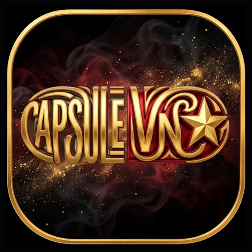
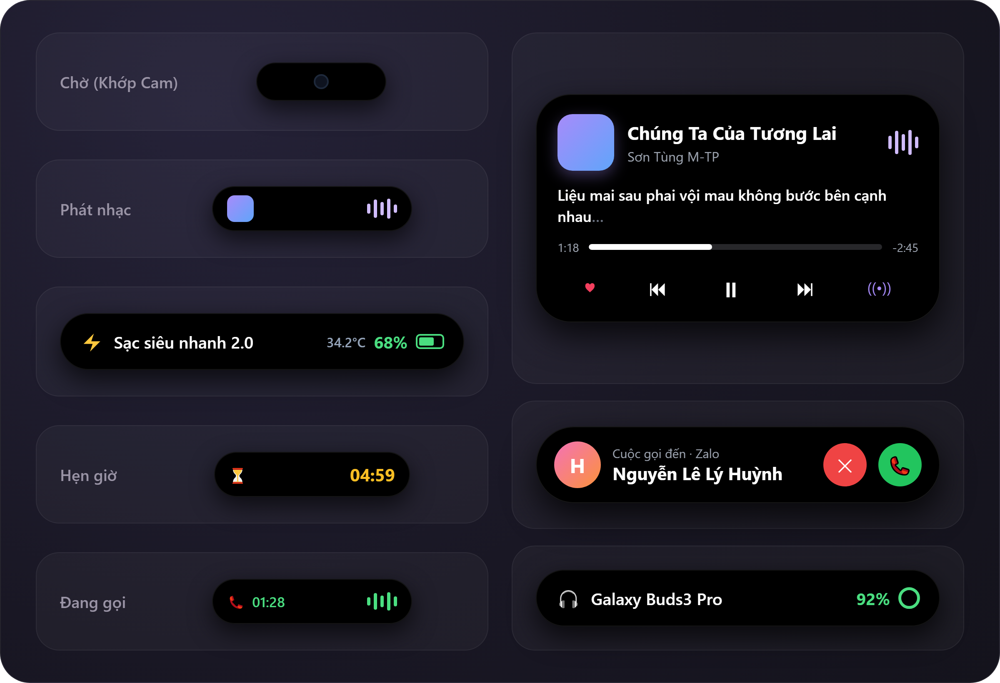
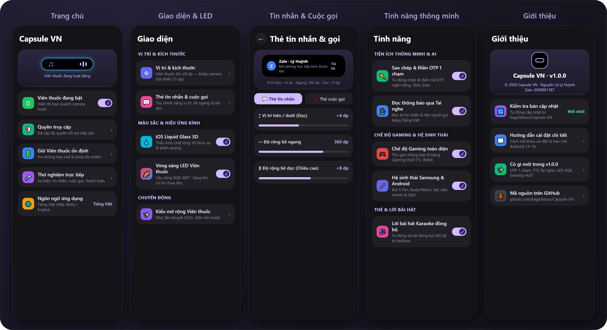
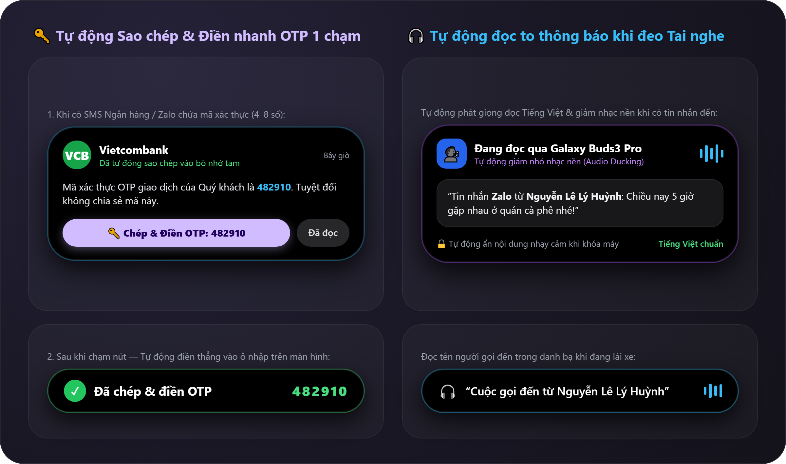
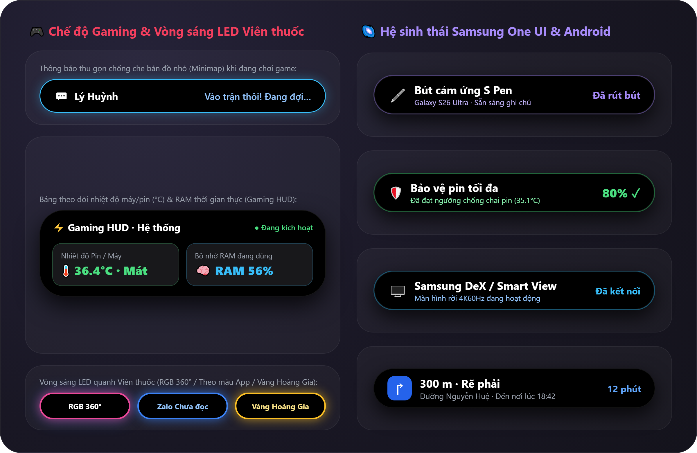
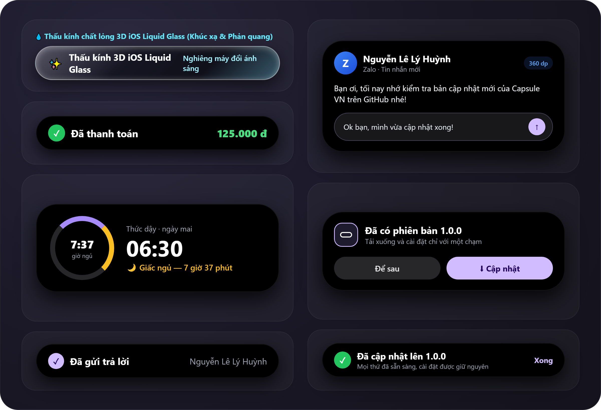

 

# 💊 Capsule VN — Viên thuốc thông minh cho Android

**Trải nghiệm cụm Viên thuốc (Dynamic Island) thế hệ mới trên Android — Việt hóa 100%, tích hợp AI/Tiện ích thông minh, Vòng sáng LED RGB 360°, Chế độ Gaming toàn diện và Hệ sinh thái Samsung One UI & Android.**

[-3DDC84?style=for-the-badge&logo=android&logoColor=white)](https://github.com/KagaTetsuo/Capsule-VN/releases/latest)

[**⬇️ Tải xuống bản cài đặt APK mới nhất (Capsule_VN.apk)**](https://github.com/KagaTetsuo/Capsule-VN/releases/latest/download/Capsule_VN.apk) · [**📦 Xem các bản phát hành (Releases)**](https://github.com/KagaTetsuo/Capsule-VN/releases)

 

---

## 🌟 Giới thiệu về Capsule VN

**Capsule VN** biến khu vực camera đục lỗ trên màn hình điện thoại Android (đặc biệt tối ưu cho **Samsung Galaxy S26 Ultra / One UI 9** cũng như mọi dòng máy Samsung, Xiaomi, OPPO, Vivo, Pixel, Realme, ROG…) thành một **Viên thuốc tương tác thông minh** mượt mà chuẩn iOS.

Bình thường khi không có hoạt động, Viên thuốc có thể thu gọn ôm khít hoàn hảo vào mắt camera trước (hỗ trợ thu nhỏ chiều rộng xuống tối thiểu `15 dp`) và chỉ bung mở linh hoạt khi có thông báo, cuộc gọi, nhạc, điều hướng hoặc sự kiện hệ thống.

### 📱 Giao diện ứng dụng (100% Tiếng Việt)

  

---

## 🚀 Các tính năng đột phá trên phiên bản Capsule VN

### 1. 🔑 Tự động Sao chép & Điền nhanh mã OTP 1 chạm
- **Nhận diện mã OTP thông minh**: Tự động bóc tách mã xác thực `4–8 chữ số` từ tin nhắn SMS, ứng dụng Ngân hàng (VCB, TCB, MB, ACB, BIDV...), Zalo, Telegram, Messenger, Gmail… (tự động loại trừ số tiền, ngày tháng và phần trăm pin).
- **Tự động chép vào bộ nhớ tạm (Clipboard)**: Ngay khi tin nhắn OTP vừa tới, mã đã sẵn sàng trong bộ nhớ tạm mà không cần mở ứng dụng.
- **Điền thẳng vào ô nhập liệu chỉ với 1 chạm**: Hiển thị nút nổi bật **`[🔑 Chép & Điền OTP: 123456]`** ngay trên Viên thuốc — chạm một lần sẽ tự động điền thẳng mã OTP vào ô nhập đang mở trên màn hình.

### 2. 🎧 Tự động đọc to thông báo khi đang đeo tai nghe (Voice Announcer TTS)
- **Đọc thông báo bằng giọng đọc Tiếng Việt tự nhiên**: Tự động đọc tên ứng dụng, người gửi và nội dung tin nhắn hoặc tên người gọi đến khi bạn đang kết nối tai nghe Bluetooth (Galaxy Buds, AirPods, Sony…) hoặc tai nghe có dây — cực kỳ tiện lợi và an toàn khi đang lái xe.
- **Tự động giảm nhỏ nhạc nền (Audio Ducking)**: Khi đọc thông báo, nhạc đang phát sẽ tự động dịu xuống và tăng trở lại ngay khi đọc xong.
- **Bảo vệ quyền riêng tư**: Tự động chỉ đọc tên người gửi (ẩn nội dung chi tiết) nếu điện thoại đang khóa màn hình hoặc thông báo được đánh dấu nhạy cảm.

  

---

### 3. 🎮 Chế độ Gaming toàn diện (Hỗ trợ mọi dòng máy Android)
- **Tự động nhận diện Game**: Nhận diện danh mục `CATEGORY_GAME` của Android và hàng loạt tựa game phổ biến (*Liên Quân Mobile, PUBG Mobile, Genshin Impact, Free Fire, Tốc Chiến, Honkai: Star Rail, Roblox, Call of Duty, Mobile Legends…*).
- **Chống che màn hình khi chiến game**: Tự động chuyển các thẻ tin nhắn lớn thành **viên thuốc mini thu gọn** để không bao giờ che bản đồ nhỏ (Minimap) hay nút kỹ năng.
- **Bảng theo dõi Gaming HUD trực tiếp**: Khi mở rộng Viên thuốc trong lúc chơi game, hiển thị thời gian thực **Nhiệt độ máy/pin (`°C` — Mát / Ấm / Nóng)** và **Mức sử dụng bộ nhớ RAM (`%`)**.
- **Giữ hiển thị trong game xoay ngang**: Tùy chọn giữ Viên thuốc gọn & Gaming HUD ngay cả khi bạn bật chế độ ẩn ở màn hình ngang.

### 4. 🌈 Vòng sáng LED Viên thuốc (Capsule Edge LED Lighting)
- **Viền ánh sáng động bao quanh camera & Viên thuốc** với 5 phong cách:
  1. **Cầu vồng RGB xoay 360°**
  2. **Theo màu ứng dụng / sự kiện** (*Zalo xanh dương, Messenger, Telegram, xanh lá khi sạc…*)
  3. **Neon Cyber (Xanh - Tím - Đỏ)**
  4. **Nhịp thở Vàng Hoàng Gia (Breathing Gold)**
  5. **Màu tùy chọn theo sở thích**
- **4 chế độ kích hoạt độc lập**: Sáng báo hiệu khi có **tin nhắn chưa đọc** (tự tắt khi mở app hoặc chạm vào Viên thuốc), sáng khi có thông báo mới, sáng khi đang cắm sạc pin, hoặc luôn sáng trang trí (*Always-On LED*).

### 5. 🌌 Tích hợp sâu Hệ sinh thái Samsung One UI & Android
- **Bút cảm ứng Samsung S Pen**: Hiệu ứng Viên thuốc tự động bung mở khi rút bút hoặc cất bút S Pen trên dòng Galaxy S Ultra (S22U–S26U), Note, Z Fold, Tab.
- **Sạc siêu nhanh & Nhiệt độ Pin (`°C`)**: Phân biệt rõ **Sạc siêu nhanh 2.0 (Super Fast Charging)**, **Sạc nhanh (Fast Charging)** và sạc thường, kèm hiển thị nhiệt độ pin theo độ C.
- **Cảnh báo Bảo vệ Pin chống chai**: Thông báo trên Viên thuốc ngay khi pin sạc đạt ngưỡng bảo vệ (`80%` / `85%` / `90%`).
- **Galaxy Buds / Watch & Thiết bị đeo Bluetooth**: Hiển thị đúng tên thiết bị và vòng phần trăm pin cho tai nghe TWS & đồng hồ thông minh trên mọi hãng máy.
- **Samsung DeX / Smart View / Truyền màn hình**: Thông báo trên Viên thuốc khi kết nối hoặc ngắt màn hình rời HDMI, TV không dây hoặc Samsung DeX.

  

---

### 6. 💧 Thấu kính chất lỏng 3D chuẩn iOS Liquid Glass
- Không chỉ là lớp mờ đơn thuần: sử dụng shader **AGSL 3D Lens Distortion** tái tạo độ cong khúc xạ ánh sáng ở viền kính, tán sắc cầu vồng nhẹ và vệt phản quang chuyển động theo cảm biến con quay hồi chuyển khi bạn nghiêng máy.

### 7. 📐 Tùy chỉnh riêng Thẻ Tin nhắn, Cuộc gọi đến, Cập nhật & Độ bo góc
- Cho phép điều chỉnh độc lập từng loại thẻ thông báo:
  - **Vị trí Lên / Xuống (Dọc)**: `-30 dp` đến `+120 dp`
  - **Độ rộng bề ngang**: `220 dp` đến `440 dp`
  - **Độ rộng bề dọc (Chiều cao)**: Co giãn linh hoạt phù hợp với nội dung từng loại thẻ
  - **Độ bo góc khung thẻ**: Tùy chỉnh từ `8 dp` (góc vuông bo nhẹ) đến `44 dp` (bo tròn mềm mại chuẩn viên thuốc)
  - **Khung mô phỏng trực tiếp (Live Preview)** ngay trong màn hình cài đặt và trên Viên thuốc thực tế.

### 8. 🎵 Trình phát nhạc Karaoke, Điều hướng, Báo thức & Thanh toán NFC
- **Âm nhạc & Lời bài hát đồng bộ**: Hiển thị ảnh bìa, sóng nhạc động (Equalizer) theo màu bìa đĩa và lời bài hát chạy chữ từng từ theo giai điệu (hỗ trợ Spotify, YouTube Music, Zing MP3, Apple Music…).
- **Cuộc gọi, Tin nhắn & Trả lời trực tiếp**: Nhận/từ chối cuộc gọi, xem lịch sử hội thoại và gõ trả lời tin nhắn ngay trong Viên thuốc.
- **Điều hướng Bản đồ, Hẹn giờ, Đèn pin, Thanh toán chạm NFC** và **Tự động cập nhật 1 chạm từ GitHub**.

### 9. 🇻🇳 Trứng phục sinh đặc biệt — Ca khúc "Tuổi Trẻ Thế Hệ Bác Hồ – Tùng Dương"
- **Hiệu ứng Cờ Đỏ Sao Vàng hào hùng**: Khi bạn mở nghe bài hát **Tuổi Trẻ Thế Hệ Bác Hồ** do ca sĩ **Tùng Dương** thể hiện trên bất kỳ ứng dụng nào (Zing MP3, Spotify, YouTube Music...), Viên thuốc Capsule VN sẽ tự động phát hiện và kích hoạt chế độ bí mật:
  - **Ngôi sao vàng năm cánh** rực sáng đập theo nhịp trống hào hùng của bài hát.
  - Vòng hào quang đỏ sao vàng và các chùm pháo sáng lấp lánh bung tỏa quanh camera.
  - Biểu ngữ chạy chữ trang trọng: *“Tuổi trẻ thế hệ Bác Hồ — Khát vọng cống hiến vì Tổ quốc!”*.

  

---

## 🛠️ Hướng dẫn cài đặt & Cấp quyền trên Android 13 / 14 / 15 / 16 (One UI 9)

1. Tải file [**`Capsule_VN.apk`**](https://github.com/KagaTetsuo/Capsule-VN/releases/latest/download/Capsule_VN.apk) và cài đặt vào máy.
2. **Nếu công tắc Hỗ trợ tiếp cận (Accessibility) bị làm mờ hoặc báo *"Ứng dụng đã bị từ chối cấp quyền"* trên Android 13+ / Samsung One UI**:
   - **Bước 1**: Vào **Cài đặt → Hỗ trợ tiếp cận → Ứng dụng đã cài đặt → Capsule VN**, chạm thử vào công tắc một lần rồi bấm **Đóng** hộp thoại cảnh báo.
   - **Bước 2**: Mở **Cài đặt → Ứng dụng → Capsule VN**, chạm vào biểu tượng **3 chấm (`⋮`)** ở góc trên bên phải màn hình và chọn **Cho phép cài đặt bị hạn chế (Allow restricted settings)** (xác nhận vân tay/mã PIN).
   - **Bước 3**: Quay lại **Hỗ trợ tiếp cận → Ứng dụng đã cài đặt → Capsule VN** và gạt bật dịch vụ.
3. Cấp thêm **Quyền truy cập thông báo (Notification Access)** và đặt chế độ Pin thành **Không hạn chế (Unrestricted)** để Viên thuốc luôn hoạt động ổn định.

---

## 👤 Thông tin Tác giả & Bản quyền

- **Tên ứng dụng**: **Capsule VN** (`com.dynamicisland.vn`)
- **Phát triển & Tối ưu hóa tại Việt Nam**: **Nguyễn Lê Lý Huỳnh**
- **Liên hệ hỗ trợ (Zalo)**: **0399991787**
- **Giấy phép mã nguồn mở**: [MIT License](LICENSE)
